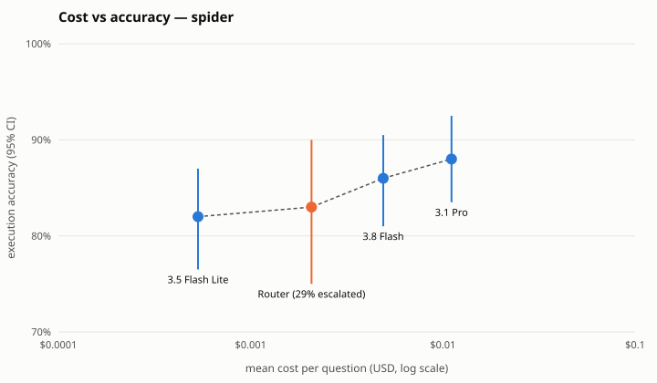

# Models and the cost/accuracy frontier

Question: for text-to-SQL on this stack, what does each point of execution
accuracy cost, and can routing or a fine-tuned small model get close to the
strong model's accuracy for less?

## Configurations

All run through the same harness (`benchmarks/text2sql.py`), same prompts,
same guard, same self-repair loop, on the same fixed 200-question stratified
Spider dev subset (`benchmarks/ablations.yaml`, section P7):

| Config | Model | Notes |
|---|---|---|
| `spider-flash-repair` | Gemini 3.8 Flash | default |
| `spider-pro-repair` | Gemini 3.1 Pro (preview) | strong model |
| `spider-qwen7b-base` | Qwen2.5-Coder 7B via Ollama | open model, no fine-tuning |
| `spider-finetuned-1.5b` | Qwen2.5-Coder 1.5B + QLoRA | `training/`, Spider train only |
| `spider-router` | Flash, escalating to Pro | `routing/`, trained on held-out half |

Any agent can use any model: `DATAAGENT_MODEL_<AGENT>=ollama/<model>` or
`gemini-*` (`core/llm.py`).

## How cost is counted

- Gemini: tokens × list price (`core/tracing.MODEL_PRICING`), including every
  self-repair attempt.
- Local models: no API bill; cost = generation seconds × `OLLAMA_USD_PER_HOUR`,
  the hourly price of the hardware used. The rate must be stated with results.

## Method

- Accuracy with 95% bootstrap CIs; every model vs the Flash baseline with a
  paired Δ CI and exact McNemar p (`python -m benchmarks.ablate`).
- Router: fit on half the questions, evaluated on the other half by replaying
  cached per-question outcomes of both models across thresholds; the chosen
  threshold is the cheapest within 1 point of Pro (`python -m routing.train`).
- Frontier: `python -m benchmarks.pareto --benchmark spider` →
  `docs/pareto_spider.svg`.

## Results (2026-10-21)

Same 200 stratified Spider dev questions; repair mode; paired vs 3.8 Flash.

| Config | EX | 95% CI | Δ vs Flash | McNemar p | $/question | p95 latency |
|---|---|---|---|---|---|---|
| Gemini 3.5 Flash-Lite | 82.0% | 76.5–87.0% | −4.0 | 0.13 | $0.00053 | 1.4 s |
| Gemini 3.8 Flash | 86.0% | 81.0–90.5% | — | — | $0.00489 | 43.6 s |
| Gemini 3.1 Pro (preview) | 88.0% | 83.5–92.5% | +2.0 | 0.42 | $0.01109 | 57.3 s |

- Neither difference is significant at n=200, but the cost and latency gaps are
  large: Flash-Lite is 9× cheaper and ~30× faster at p95 for ~4 points.
- **Router.** Trained on half the questions, evaluated on the other half
  (n=100). A Flash-Lite → **Pro** router reached Pro's 84% only at 66% of Pro's
  cost — and plain 3.8 Flash scored the same 84% on those questions for less, so
  escalating to Pro is dominated. A Flash-Lite → **Flash** router matches Flash's
  84% at 59% of Flash's cost (38% of questions escalated), or 83% at 48%. With
  n=100 the CIs are ±7 pts; treat as promising, not settled.
- Fine-tuned 1.5B model and local Qwen-7B: **pending** (GPU run / Ollama).
